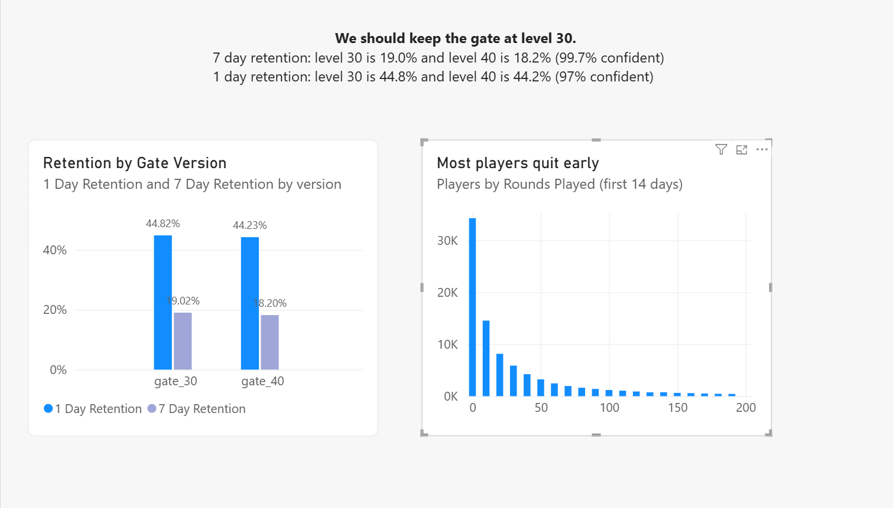

# Cookie Cats A/B Test: Gate at Level 30 vs Level 40

## Question
Cookie Cats is a mobile puzzle game where players hit a gate and have to wait or pay to keep playing. The company tested moving the gate from level 30 to level 40. I wanted to find out which gate keeps more players coming back.

## Answer
Keep the gate at level 30. It keeps slightly more players at both 1 day and 7 days, and the 7 day result is very unlikely to be luck.

| Version | Players | 1 Day Retention | 7 Day Retention | Avg Rounds |
|---|---|---|---|---|
| Gate 30 | 44,699 | 44.82% | 19.02% | 51.34 |
| Gate 40 | 45,489 | 44.23% | 18.20% | 51.30 |

Bootstrap confidence that gate 30 is better (1,000 resamples):
* 7 day retention: 99.7%
* 1 day retention: 97%

## Data
* Source: Mobile Games A/B Testing, Cookie Cats (Kaggle)
* 90,189 players, randomly assigned to gate 30 or gate 40
* One row is one player: their version, rounds played in the first 14 days, and whether they came back after 1 day and 7 days

## Cleaning Decisions
* **Removed 1 player with 49,854 rounds.** That's about 3,500 rounds a day, which isn't realistic, so it's likely a bot or a data error. The next highest players were in the 2,000s, which is possible for a hardcore player. The clean table has 90,188 players.
* **Kept the ~4,000 players with 0 rounds.** They never reached a gate, but both versions had about the same number of them, so keeping them keeps the comparison fair.

## Key Findings
1. Gate 30 has 0.82 percentage points higher 7 day retention (19.02% vs 18.20%) and 0.59 points higher 1 day retention (44.82% vs 44.23%).
2. The differences are small, but bootstrapping shows they are very likely real and not random noise, especially for 7 day retention.
3. Most players quit early. About 34,000 of 90,000 players played fewer than 10 rounds in their first 14 days, so many never reach either gate. That's why the gate only makes a small difference overall.

## Recommendation
* Keep the gate at level 30.
* Focus on engagement in the early rounds, since that's where most players are lost.
* Run a new A/B test to see if an even earlier gate (like level 20) helps more. This data only compared 30 vs 40, so it can't tell us that yet.

## What the Data Can't Tell Us
* **Why** players came back. One theory is that an earlier gate gives players a break so they don't burn out, but the data only shows what happened, not why.
* **Who paid vs. who waited** at the gate. Without purchase data, we don't know which version makes more money.
* **Rounds aren't exactly levels.** Players can replay levels they fail, so 30 rounds doesn't always mean they reached level 30.

## Tools
* **BigQuery:** loading, cleaning, and summary tables in SQL
* **Python (Google Colab, pandas):** bootstrap analysis
* **Power BI:** dashboard

## How to Rerun
1. Download the Cookie Cats CSV from Kaggle and upload it to BigQuery.
2. Run the SQL in `/sql` to create `players_clean` and `version_summary`.
3. Run the notebook in `/notebooks` for the bootstrap.
4. Open `cookie_cats_dashboard.pbix` in Power BI and refresh.
